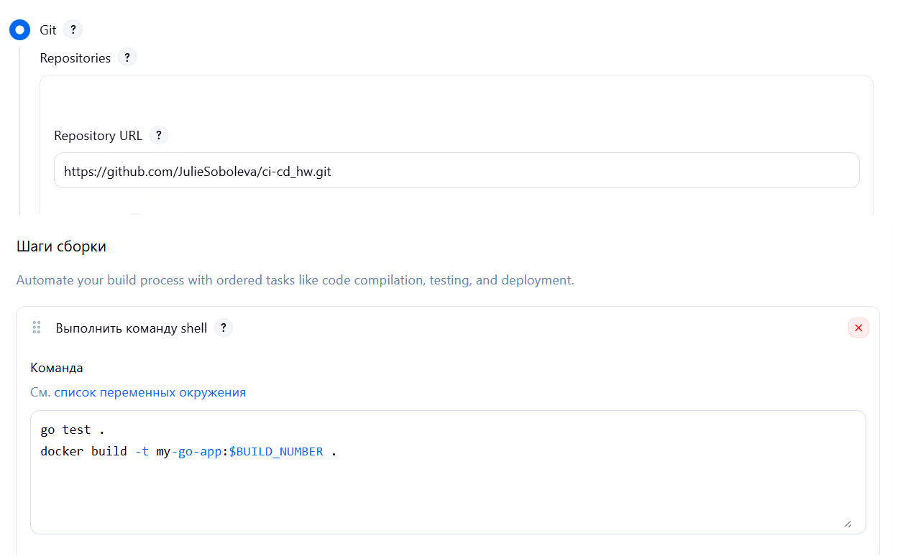
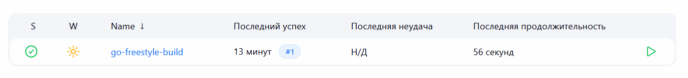
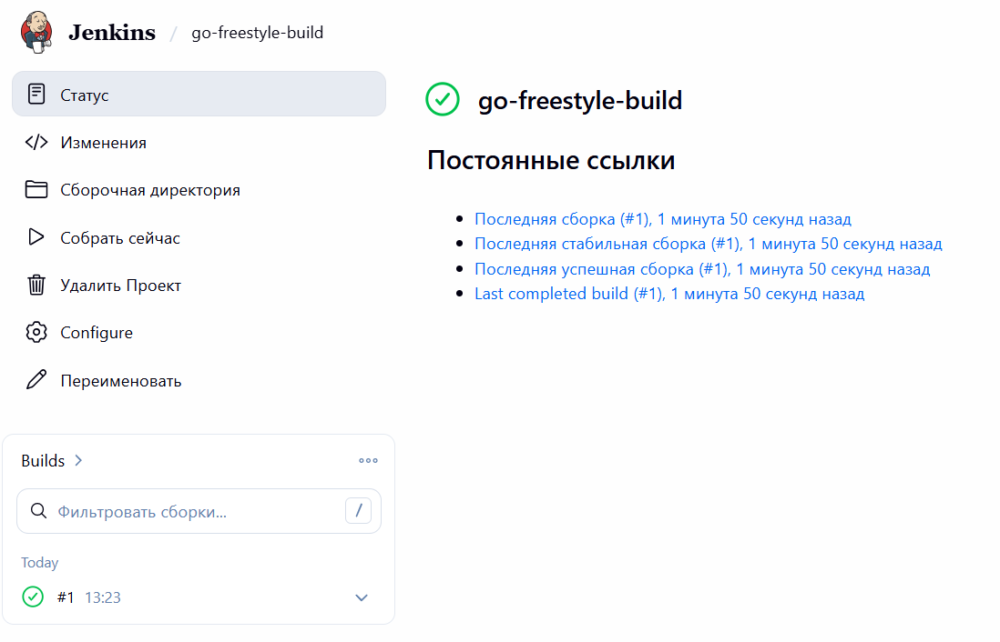
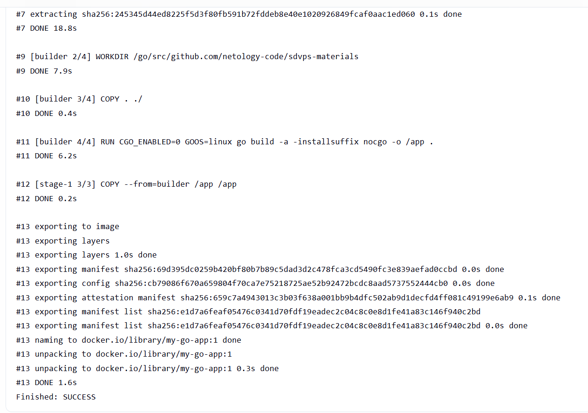
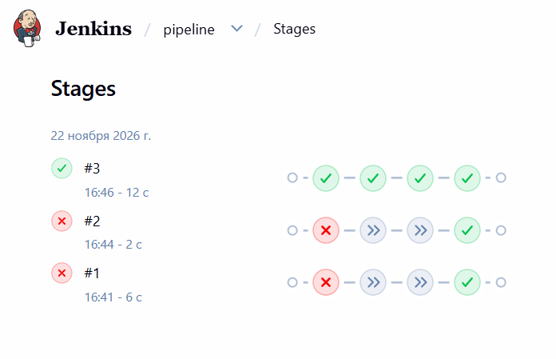
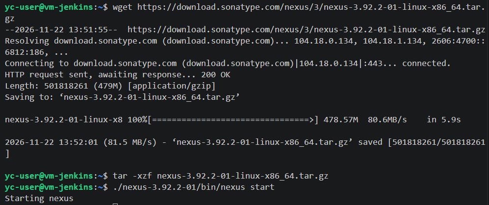

# Домашнее задание к занятию "Что такое DevOps. CI/CD"

---

## Задание 1: Jenkins Freestyle Project

**Что было сделано:**
1. Развернута ВМ в Yandex Cloud (`vm-jenkins`, Ubuntu).
2. Установлен Jenkins и Go (через `apt`).
3. Создан Freestyle Project, подключен репозиторий.
4. Настроены шаги сборки: `go test .` и `docker build`.
5. Пользователь `jenkins` добавлен в группу `docker` для предоставления прав.

**Скриншоты:**
*   *Настройки проекта (URL репозитория и шаги сборки):*
    
*   *Успешное выполнение сборки (Console Output):*
    
    
    

---

## Задание 2: Declarative Pipeline

**Что было сделано:**
Сборка из задания 1 переписана в виде кода (Declarative Pipeline) и сохранена в проекте.

**Код Pipeline:**
```groovy
pipeline {
    agent any

    stages {
        stage('Checkout') {
            steps {
                git branch: 'main', url: 'https://github.com/JulieSoboleva/ci-cd_hw.git'
            }
        }
        stage('Test') {
            steps {
                sh 'go test .'
            }
        }
        stage('Docker Build') {
            steps {
                sh 'docker build -t my-go-app:${BUILD_NUMBER} .'
            }
        }
    }
}
```

**Скриншот:**



---

## Задание 3: Nexus и загрузка бинарного файла

**Что было сделано:**
1. Установлен Nexus Repository Manager на ВМ.
2. В Nexus создан raw-hosted репозиторий с именем `go-binaries`.
3. Pipeline изменен: вместо `docker build` выполняется компиляция Go-бинарника (`go build`).
4. Настроена загрузка файла в Nexus через `curl` с использованием Jenkins Credentials.

**Измененный фрагмент Pipeline (стадии сборки и загрузки):**
```groove
        stage('Build Binary') {
            steps {
                sh 'CGO_ENABLED=0 GOOS=linux go build -a -installsuffix nocgo -o myapp .'
            }
        }

        stage('Upload to Nexus') {
            steps {
                withCredentials([usernamePassword(credentialsId: 'nexus-credentials', usernameVariable: 'NEXUS_USER', passwordVariable: 'NEXUS_PASS')]) {
                    sh '''
                        curl -v -u ${NEXUS_USER}:${NEXUS_PASS} \
                        --upload-file myapp \
                        http://153.51.171.0:8081/repository/go-binaries/myapp-latest
                    '''
                }
            }
        }
```

**Скриншот:**



---

## Задание 4*: Версионирование через BUILD_NUMBER

**Что было сделано:**
Для сохранения истории релизов в имени загружаемого файла используется встроенная переменная Jenkins `${BUILD_NUMBER}`. Каждая новая сборка создает файл с уникальным номером.

**Измененный шаг загрузки:**
```groovy
        stage('Upload to Nexus with Version') {
            steps {
                withCredentials([usernamePassword(credentialsId: 'nexus-credentials', usernameVariable: 'NEXUS_USER', passwordVariable: 'NEXUS_PASS')]) {
                    sh '''
                        curl -v -u ${NEXUS_USER}:${NEXUS_PASS} \
                        --upload-file myapp \
                        http://153.51.171.0:8081/repository/go-binaries/myapp-v${BUILD_NUMBER}.bin
                    '''
                }
            }
        }
```
---